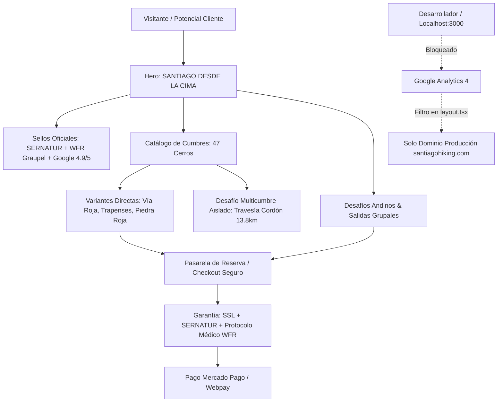

# Registro Maestro de Actividad y Arquitectura · Gaz_Style / Santiago Hiking

> **Fecha de Actualización:** 17 de Octubre, 2026  
> **Plataforma:** [Santiago Hiking](https://www.santiagohiking.com) (`Gaz_Style Expeditions`)  
> **Repositorio Oficial:** `https://github.com/Gaz-Style/Gaz_Style-.git` · Rama: `main` (Commit: `ab2b706`)  
> **Stack:** Next.js 14 (App Router) · React 18 · TypeScript · TailwindCSS · Supabase (PostgreSQL) · Mercado Pago · GA4 / GTM  

---

## 1. Resumen Ejecutivo de la Intervención

Durante este ciclo operativo se completó una transformación integral en cinco ejes estratégicos:
1. **Auditoría Forense y Filtro de Tráfico en Google Analytics (GA4):** Identificación y corrección de distorsión por tráfico local (`localhost`), aislando la analítica real de clientes.
2. **Refinamiento Quirúrgico de Copywriting & Marca:** Erradicación total de elementos de cotillón ("café", "bastones técnicos", "guías WFR", "logística resuelta") que abarataban la percepción de valor, adoptando un tono de montaña sobrio, seguro y de alta gama.
3. **Integración de Credenciales Oficiales de Confianza:** Montaje visual de los sellos oficiales **SERNATUR (Sello R)** y **Wilderness First Responder (WFR - Graupel)** en Hero, Checkout y Footer.
4. **Desacople Arquitectónico de Senderos:** Separación estricta entre variantes de cumbre directa y travesías integrales de cordón para no distorsionar métricas de ascenso.
5. **Catálogo de Cerros y Base de Datos Supabase:** Purga de menciones a competidores (`AHB`), habilitación del panel administrativo `/admin/cerros` y sincronización con GitHub.

---

## 2. Diagrama de Flujo y Estado de la Plataforma



---

## 3. Bitácora Detallada de Actividades Realizadas

### A. Auditoría Forense Google Analytics 4 (GA4)
* **ID de Propiedad:** `558498455` (Stream `G-BPRY7P4YPL`).
* **Diagnóstico de Datos:** Se descubrió que el 78.7% de los eventos previos correspondían a pruebas en `localhost:3000` (3 usuarios locales acumulando 515 vistas de página y sesiones de 31 minutos).
* **Tráfico Real de Producción:**
  - **88 visitantes únicos** reales identificados.
  - Distribución: 61 Desktop (69.3%) y 29 Mobile (32.9%).
  - Páginas con mayor intención de compra orgánica:
    1. `/desafios/sierra-de-ramon` (Interés en alta resistencia y travesía).
    2. `/desafios/desafio-5am` (Alta tasa de lectura en ascensos al alba).
    3. `/reservar` (Paso por checkout y consultas de disponibilidad).
* **Solución Técnica Aplicada:** Modificación en [layout.tsx](file:///c:/Users/ADMIN/Downloads/IA%20trabajaos/gaz_style/src/app/layout.tsx) para descartar condicionalmente la inicialización de `gtag('config')` cuando `window.location.hostname === 'localhost'` o `127.0.0.1`.

### B. Limpieza Editorial y Filosofía de Marca (Anti-Café & Anti-Clichés)
* **Principio Rector:** *"En una expedición de montaña premium, el cliente paga por la cumbre, la seguridad, la cordada y el liderazgo. La logística resuelta, los bastones de apoyo y la certificación médica son el piso mínimo implícito, no ítems de cotillón para justificar un cobro."*
* **Acciones Ejecutadas:**
  - **Erradicación del Café:** 0 ocurrencias en todo el directorio `src/` (eliminado en español, inglés, francés, portugués y alemán de [i18n.ts](file:///c:/Users/ADMIN/Downloads/IA%20trabajaos/gaz_style/src/lib/i18n.ts), formularios de leads, rutas, desafíos, creador admin y prompts de IA).
  - **Supresión de Clichés Pedestres:** Se eliminaron las frases promocionales *"bastones técnicos incluidos"*, *"guías certificados WFR"* como reclamo comercial ruidoso y *"logística resuelta"*.
  - **Nuevo Copy Oficial del Hero:**
    - **Título Principal:**
      ```
      SANTIAGO DESDE
      LA CIMA.
      ```
    - **Bajada Factual y Directa (Sin poesía vacía):**
      > *«Expediciones de montaña, ascensos al atardecer y cumbres en los Andes centrales. Salidas grupales y privadas por los cerros más icónicos de Santiago, desde rutas clásicas hasta desafíos de alta exigencia.»*

### C. Integración de Sellos Oficiales de Acreditación (Trust Badges)
Se normalizaron los archivos gráficos en el directorio `/public`:
- [logo-sernatur.png](file:///c:/Users/ADMIN/Downloads/IA%20trabajaos/gaz_style/public/logo-sernatur.png): **Sello R oficial de Prestador Turístico Registrado SERNATUR**.
- [logo-wfr-graupel.webp](file:///c:/Users/ADMIN/Downloads/IA%20trabajaos/gaz_style/public/logo-wfr-graupel.webp): **Insignia oficial de Wilderness First Responder (WFR - Graupel / Medicina en Áreas Remotas)**.

**Puntos de Inyección:**
1. **Hero Superior ([page.tsx](file:///c:/Users/ADMIN/Downloads/IA%20trabajaos/gaz_style/src/app/page.tsx)):** Píldoras flotantes con los logos circulares oficiales en alta definición.
2. **Pasarela de Pago ([BookingClient.tsx](file:///c:/Users/ADMIN/Downloads/IA%20trabajaos/gaz_style/src/app/reservar/BookingClient.tsx)):** Fila de validación institucional bajo los métodos de pago Webpay/Mercado Pago.
3. **Pie de Página Institucional ([Footer.tsx](file:///c:/Users/ADMIN/Downloads/IA%20trabajaos/gaz_style/src/components/Footer.tsx)):** Tarjetas compactas en glassmorphism con estado de acreditación.

### D. Desacople de Rutas y Corrección Topográfica
* **Problema Identificado:** En la ficha técnica del Cerro Manquehue, la inclusión de la *Travesía Integral Cordón Manquehue (13.8 km)* distorsionaba el promedio y confundía a los usuarios que buscaban el ascenso directo a la cumbre (4.8 km a 6.2 km).
* **Solución Implementada:**
  - El selector de variantes ahora solo ofrece las **4 rutas directas a la cumbre**:
    1. *Vía Roja (Clásica por Lo Curro - 4.8 km)*
    2. *Los Trapenses (Arista Nororiente - 5.4 km)*
    3. *Piedra Roja / Chicureo (Vertiente Norte - 6.2 km)*
    4. *Travesía Local Norte-Sur (6.8 km)*
  - La *Travesía Integral Cordón Manquehue* fue aislada en su propia tarjeta destacada como **"Desafío Multicumbre"**, protegiendo la claridad técnica de la ficha.

### E. Expansión Supabase & Panel de Administración
* **Catálogo Maestro:** 47 cumbres de la Región Metropolitana y Andes Centrales catalogadas con geomorfología, acceso Waze, transporte público y variantes técnicas.
* **Purga de Competidores:** Búsqueda y reemplazo en vivo en Supabase y scripts SQL de cualquier mención a `AHB` o `Andeshandbook`.
* **Panel de Gestión:** Centralización en `/admin/cerros` con 3 pestañas dinámicas (Cumbres, Puntos de Acceso / Waze, Senderos y Variantes) y redirección automática de `/admin/atlas`.

---

## 4. Matriz de Archivos Clave Modificados

| Archivo | Tipo de Cambio | Impacto |
| :--- | :--- | :--- |
| [src/lib/i18n.ts](file:///c:/Users/ADMIN/Downloads/IA%20trabajaos/gaz_style/src/lib/i18n.ts) | Copywriting Multilingüe | Hero oficial sin café/poesía; estandarización en ES, EN, FR, PT, DE |
| [src/app/page.tsx](file:///c:/Users/ADMIN/Downloads/IA%20trabajaos/gaz_style/src/app/page.tsx) | Frontend Hero | Inyección de sellos oficiales SERNATUR y WFR Graupel en badges |
| [src/app/layout.tsx](file:///c:/Users/ADMIN/Downloads/IA%20trabajaos/gaz_style/src/app/layout.tsx) | Analítica & Tracking | Filtro localhost en GA4 para no alterar estadísticas reales |
| [src/app/reservar/BookingClient.tsx](file:///c:/Users/ADMIN/Downloads/IA%20trabajaos/gaz_style/src/app/reservar/BookingClient.tsx) | Conversión & Checkout | Sellos institucionales de seguridad pre-pago |
| [src/components/Footer.tsx](file:///c:/Users/ADMIN/Downloads/IA%20trabajaos/gaz_style/src/components/Footer.tsx) | Footer Institucional | Módulo de acreditaciones oficiales con diseño de cristal |
| [src/app/admin/cerros/CerrosAdminClient.tsx](file:///c:/Users/ADMIN/Downloads/IA%20trabajaos/gaz_style/src/app/admin/cerros/CerrosAdminClient.tsx) | Panel Admin | Gestión visual de 47 cumbres, accesos Waze y senderos |
| [src/app/cerros/[slug]/CerroDetailClient.tsx](file:///c:/Users/ADMIN/Downloads/IA%20trabajaos/gaz_style/src/app/cerros/[slug]/CerroDetailClient.tsx) | UX de Cumbres | Desacople de travesías cordón y variantes directas |

---

## 5. Estado de Compilación y Control de Versiones

```bash
# Verificación de Tipos TypeScript
npx tsc --noEmit
# Resultado: 0 errores, compilación limpia.

# Registro en Git & Push a Producción
commit: ab2b706
branch: main -> origin/main
remote: https://github.com/Gaz-Style/Gaz_Style-.git
status: Working tree clean (100% sincronizado)
```

---

> **Nota de Gobernanza Técnica:**  
> Las menciones de café o elementos de tabla básica quedan terminantemente vetadas de futuros copys o campañas para mantener la consistencia del posicionamiento de alta montaña de Santiago Hiking.
